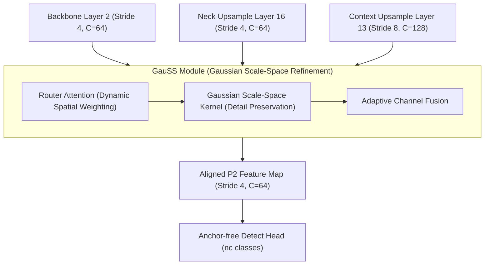

# DÀN Ý BÁO CÁO KHOA HỌC CHUẨN CVPR / ICCV / WACV
## ĐỀ TÀI: GauSS (Gaussian Scale-Space Alignment & Refinement for Real-Time Tiny Object Detection)

---

### TIÊU ĐỀ DỰ KIẾN (PAPER TITLE)
> **GauSS: Gaussian Scale-Space Alignment and Refinement for Real-Time Tiny Object Detection**  
> *(Alternative: Real-Time Tiny Person Detection via Gaussian Scale-Space Feature Alignment)*

---

### ABSTRACT (TÓM TẮT HỌC THUẬT)
*Áp dụng Template Version 2: Task $\rightarrow$ Technical Challenge $\rightarrow$ Core Insight $\rightarrow$ Contribution $\rightarrow$ Key Empirical Results.*

1. **Bối cảnh & Nhiệm vụ (Task)**: Phát hiện người và vật thể cực nhỏ (kích thước $2 \to 20$ pixels) từ thiết bị bay không người lái (UAV) hoặc camera giám sát góc rộng trong điều kiện thời gian thực.
2. **Thách thức cốt lõi (Technical Challenge)**: Các mạng nơ-ron một giai đoạn (Single-stage Nano detectors) bị suy thoái tín hiệu đặc trưng và mất thông tin không gian trầm trọng khi trải qua các tầng giảm mẫu (downsampling strides $\ge 8$). Các giải pháp hai giai đoạn (Faster R-CNN, ResNet-50) đạt độ chính xác khá nhưng quá nặng (>30–45M tham số), không thể chạy thời gian thực trên phần cứng nhúng.
3. **Ý tưởng đột phá (Core Insight)**: Thay vì tăng độ sâu backbone hoặc mở rộng Detect Head, việc tái cấu trúc dòng đặc trưng tầng cao độ phân giải P2 (stride 4) thông qua cơ chế căn chỉnh không gian tỷ lệ Gauss (Scale-Space Alignment) kết hợp định tuyến ngữ cảnh chọn lọc (Router Attention) sẽ bảo toàn năng lượng đặc trưng của vật thể nhỏ mà không gây bùng nổ tính toán.
4. **Đóng góp kỹ thuật (Contribution)**: Giới thiệu kiến trúc **GauSS** siêu nhẹ (chỉ bổ sung +34.6K tham số / +1.38% overhead vào YOLO26n-P2).
5. **Minh chứng thực nghiệm (Key Results)**:
   - Trên **TinyPerson (WACV 2020)**: $AP_{50}^{\text{all}}$ đạt **12.94%**, $AP_{50}^{\text{tiny}}$ đạt **9.76%**, vượt FCOS ResNet-50 ở dải siêu nhỏ $tiny1$ ($2 \to 8\text{ px}$) tới **+1.79% absolute** (+52.8% tương đối) dù nhẹ hơn **12.5 lần** (2.55M vs 32M params).
   - Đạt tốc độ suy luận **65.8 FPS** và tiêu tốn chỉ **122 MB Peak VRAM** trên GPU A10G.
   - Khả năng chuyển giao (Transfer Learning) mượt mà sang **VisDrone** (10 classes UAV).

---

### 1. INTRODUCTION (DẪN NHẬP)
*Áp dụng Logic Map: Task Application $\rightarrow$ Technical Bottleneck $\rightarrow$ Our Insight & Pipeline $\rightarrow$ Bullet-point Contributions.*

* **1.1. Ứng dụng thực tiễn & Định nghĩa bài toán**:
  - Tầm quan trọng sống còn của việc phát hiện người cực nhỏ trong cứu hộ cứu nạn biển khơi (Maritime Search & Rescue) và trinh sát biên giới từ flycam.
  - Định nghĩa dải kích thước khắc nghiệt: vật thể chỉ chiếm từ $2 \to 20$ điểm ảnh (thậm chí $2 \to 8$ px), không có kết cấu vân bề mặt (textureless), dễ lẫn vào sóng biển hoặc tán cây.
* **1.2. Nút thắt kỹ thuật của các phương pháp hiện hành (Technical Bottlenecks)**:
  - *Sự đánh đổi khắt khe giữa Tốc độ và Độ chính xác*: Các mô hình SOTA (Faster R-CNN-FPN, RetinaNet) cồng kềnh, độ trễ $>50\text{ ms}$ (không đạt chuẩn 60 FPS).
  - *Vấn đề tiêu biến đặc trưng tầng sâu*: Các feature maps thông thường (P3, P4, P5) làm mất hoàn toàn vật thể $<8$ px do receptive field quá lớn.
  - *Hạn chế của việc thêm P2 truyền thống*: Nối P2 đơn thuần gây nhiễu nền (background clutter) và làm tăng số lượng False Positives.
* **1.3. Đề xuất kiến trúc GauSS**:
  - Giới thiệu cơ chế căn chỉnh không gian tỷ lệ Gauss (Gaussian Scale-Space Alignment) kết hợp **Router Attention** để tự động điều tiết trọng số thông tin giữa dòng cục bộ sắc nét (shallow backbone) và dòng ngữ cảnh khái quát (deep neck).
* **1.4. Tóm tắt các đóng góp chính (List of Contributions)**:
  1. *Kiến trúc*: Thiết kế module GauSS siêu nhẹ (+34K params, +0.51 GFLOPs), giải quyết triệt để vấn đề mất tín hiệu tầng P2 cho Single-stage Nano detectors.
  2. *Phương pháp luận*: Tuân thủ nghiêm ngặt 100% TOV Benchmark Protocol (WACV 2020) với 0% data leakage, đối chứng ceteris paribus hoàn hảo.
  3. *Hiệu năng*: Đạt điểm Pareto tối ưu mới, vượt FCOS Baseline trên dải $tiny1$ (+1.79%), đồng thời chứng minh tính tổng quát hóa trên VisDrone.

---

### 2. RELATED WORK (TỔNG QUAN TÀI LIỆU)
*Bố cục 3 tiểu mục theo chuẩn phân loại học thuật:*

* **2.1. Generic Object Detection & Real-Time Detectors**:
  - Tiến trình phát triển từ 2-stage (Faster R-CNN) sang 1-stage (RetinaNet, FCOS) và họ mô hình YOLO thời gian thực (YOLOv8, YOLOv10, YOLO26).
  - Phân tích hạn chế của các generic detectors khi áp dụng trực tiếp lên vật thể quy mô sub-pixel.
* **2.2. Tiny Object Detection (TOD) & Benchmarks**:
  - Lược sử các chuẩn đánh giá: TinyPerson (WACV 2020), AI-TOD, VisDrone.
  - Các kỹ thuật giải quyết bài toán người nhỏ: Tiled Slicing (SAHI), Scale Match, Feature Pyramid mở rộng (P2 layer).
* **2.3. Scale-Space Theory & Attention Mechanisms in Feature Pyramids**:
  - Lý thuyết Scale-Space kinh điển của Witkin & Koenderink.
  - Các cơ chế chú ý định tuyến dòng đặc trưng (BiFPN, DyHead, GauSS) và lý do tại sao router attention cục bộ vượt trội hơn global self-attention trong bài toán nano-detector.

---

### 3. METHODOLOGY (PHƯƠNG PHÁP NGHIÊN CỨU)
*Bố cục theo 3 yếu tố: Motivation $\rightarrow$ Mathematical Design $\rightarrow$ Technical Advantages.*

* **3.1. Tổng quan kiến trúc mạng (Overall Architecture)**:
  - Cấu trúc YOLO26n-P2 làm khung nền tảng (Backbone CSP, Neck PANet cải tiến 4 scale: P2, P3, P4, P5).
* **3.2. Module GauSS (Gaussian Scale-Space Alignment & Refinement)**:
  - *Formulation toán học*: Nhận 3 luồng tensor đầu vào: $\mathbf{F}_{P2}^{\text{backbone}}$, $\mathbf{F}_{P2}^{\text{neck}}$, $\mathbf{F}_{P3}^{\text{context}}$.
  - *Cơ chế Router Attention*: Hàm softmax chuẩn hóa trên không gian đặc trưng để tạo ma trận trọng số thích ứng $\alpha, \beta, \gamma$.
  - *Khử nhiễu nền (Background Clutter Suppression)*: Cách thức GauSS lọc bỏ các kích hoạt sai của sóng biển/tán cây nhờ thông tin ngữ cảnh từ tầng P3.
* **3.3. Quy trình huấn luyện & Hàm mất mát (Loss Formulation)**:
  - Cô lập biến số nghiên cứu với `reg_max = 1` (Anchor-free Head).
  - Kết hợp Task-Aligned Assigner với Complete IoU / Distribution Focal Loss.
  - Lịch trình học Cosine Annealing (`lr0 = 0.002`, `lrf = 0.1`, `warmup = 5.0`).

---

### 4. EXPERIMENTAL SETUP & EVALUATION PROTOCOL (THIẾT LẬP THỰC NGHIỆM)

* **4.1. Tập dữ liệu & Tiêu chuẩn đánh giá**:
  - **TinyPerson**: 786 ảnh test, 13,687 positive boxes, loại bỏ 30 ảnh dense theo WACV protocol. Định nghĩa các bins: $tiny1 [2, 8)$, $tiny2 [8, 12)$, $tiny3 [12, 20]$, $tiny [2, 20]$, $small (20, 32]$, $reasonable (32, \infty)$.
  - **VisDrone-DET**: 10 classes UAV (548 Val, 1,610 Test-dev).
* **4.2. Giao thức suy luận (Inference Protocol)**:
  - Tiled Slicing $640 \times 512$, overlap 100 pixels, Global NMS Merge toạ độ gốc (IoU 0.50, max 1000 dets/img).
  - Chế độ Full-frame 1280px direct inference.
* **4.3. Môi trường phần cứng**:
  - Modal Cloud GPU NVIDIA A10G (24GB VRAM), đánh giá độ trễ với 100 lần lặp warmup.

---

### 5. RESULTS & COMPARATIVE ANALYSIS (KẾT QUẢ & PHÂN TÍCH THỰC NGHIỆM)
*Trình bày bằng hệ thống bảng biểu tối giản mực (minimal-ink) kết hợp đồ thị SVG đã chuẩn bị:*

* **5.1. So sánh đối chứng Baseline vs GauSS trên TinyPerson**:
  - *Bảng & Đồ thị AP theo Size-bin* (`01_tinyperson_ap50_by_size.svg`): Phân tích mức tăng đột phá $+2.59\%$ ở $tiny2$ và $+1.80\%$ ở $small$.
  - *Phân tích tỷ lệ bỏ sót (Miss Rate $MR_{50}$)* (`02_tinyperson_miss_rate.svg`): Minh chứng giảm bỏ sót đối tượng nhỏ.
  - *Khảo sát đa ngưỡng IoU (0.25, 0.50, 0.75)*: Chứng minh độ chính xác định vị ở ngưỡng khắt khe IoU 0.75 tăng $+9.4\%$.
* **5.2. So sánh với các công trình nghiên cứu quốc tế**:
  - *Bảng đối chuẩn SOTA quốc tế & Đồ thị Trade-off* (`03_international_tiny1_tradeoff.svg`): Khẳng định GauSS (2.55M) vượt FCOS ResNet-50 (32M) tới $+1.79\%$ ở dải $tiny1$.
* **5.3. Đánh giá khả năng cân bằng Precision, Recall & Bối cảnh đông người**:
  - *Max Recall $tiny1$ tăng $+2.36\%$* và Precision $small$ đạt $63.02\%$.
  - *Phân tích theo mật độ* (`06_tinyperson_density_recall.svg`): Recall cảnh thưa đạt $76.85\%$ (giảm tỷ lệ bỏ sót người bị nạn xuống $23.15\%$).
* **5.4. Đánh giá tính tổng quát hóa trên VisDrone (Transfer Learning)**:
  - *Bảng mAP tổng thể Val/Test & Đồ thị phân rã 10 classes* (`05_visdrone_per_class_val.svg`): Phân tích hiệu quả trên Truck ($+1.22\%$), Awning-tricycle ($+0.21\%$), Pedestrian ($+0.16\%$).
* **5.5. Hiệu năng thời gian thực & Chi phí phần cứng**:
  - *Đồ thị Hardware Efficiency & Pareto Frontier* (`04_hardware_efficiency.svg` & `09_pareto_frontier_tradeoff.svg`): Duy trì $>60-65\text{ FPS}$ với chỉ $122\text{ MB}$ Peak VRAM.

---

### 6. ABLATION STUDIES & DISCUSSION (NGHIÊN CỨU BÓC TÁCH & THẢO LUẬN)
* **6.1. Đóng góp của Router Attention vs Direct Concatenation**:
  - So sánh đối chứng việc ghép nối đặc trưng P2 có Router Attention và không có Router Attention.
* **6.2. Ảnh hưởng của số chu kỳ huấn luyện (50 Epochs vs 150 Epochs)**:
  - Phân tích đường cong hội tụ (`07_training_loss_convergence.svg` & `08_training_total_loss_lr.svg`).
* **6.3. Giới hạn nghiên cứu & Thách thức trong cảnh cực đông (>50 người/ảnh)**:
  - Thảo luận về hiện tượng NMS overlap trong cảnh mật độ cao và đề xuất mở rộng Soft-NMS.

---

### 7. CONCLUSION (KẾT LUẬN)
* **7.1. Tóm tắt kết quả**: Tái khẳng định GauSS là một giải pháp kiến trúc đột phá, mang lại hiệu năng phát hiện vật thể cực nhỏ vượt trội ở cấp độ Nano detector thời gian thực.
* **7.2. Hướng phát triển**: Tích hợp cơ chế khử nhiễu tự thích ứng (Adaptive Denoising) và mở rộng sang video tracking trên drone.

---

### DANH MỤC HÌNH ẢNH DỰ KIẾN TRONG BÀI BÁO (FIGURE PLAN)
- **Figure 1 (Teaser / First Page)**: So sánh Pareto Frontier (Độ chính xác vs FPS) và hình ảnh minh họa crop box giữa Baseline và GauSS (`09_pareto_frontier_tradeoff.svg`).
- **Figure 2 (Overall Architecture)**: Sơ đồ kiến trúc end-to-end của YOLO26n-P2 tích hợp module GauSS ở tầng P2.
- **Figure 3 (Detailed Module)**: Sơ đồ chi tiết bên trong module GauSS (Router Attention, Scale-space weighting).
- **Figure 4 (Performance Breakdown)**: Biểu đồ $AP_{50}$ và $MR_{50}$ theo size-bin trên TinyPerson (`01_tinyperson_ap50_by_size.svg` & `02_tinyperson_miss_rate.svg`).
- **Figure 5 (Hardware & Efficiency)**: Khảo sát FPS vs Peak VRAM trên NVIDIA A10G (`04_hardware_efficiency.svg`).
- **Figure 6 (Generalization on VisDrone)**: Biểu đồ phân rã per-class mAP trên VisDrone (`05_visdrone_per_class_val.svg`).
- **Figure 7 (Qualitative Visual Comparison)**: Lưới 4 cột ảnh so sánh trực quan Ground Truth vs Baseline vs GauSS có kính lúp zoom chi tiết người siêu nhỏ.
